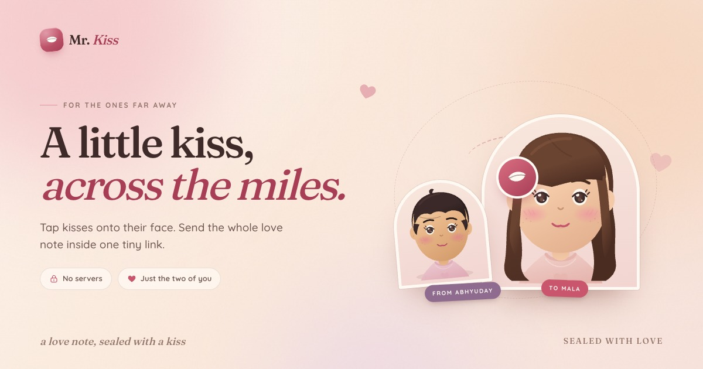
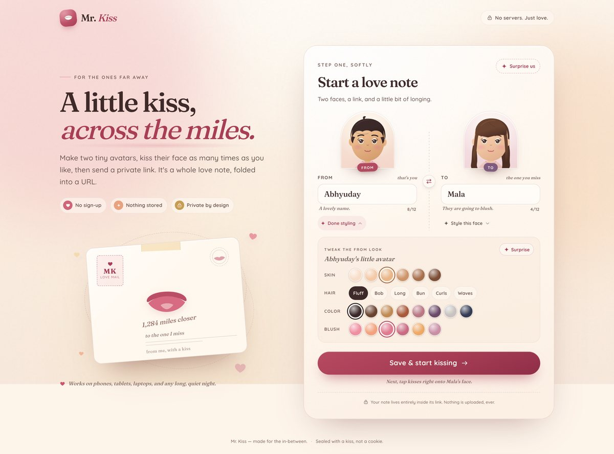
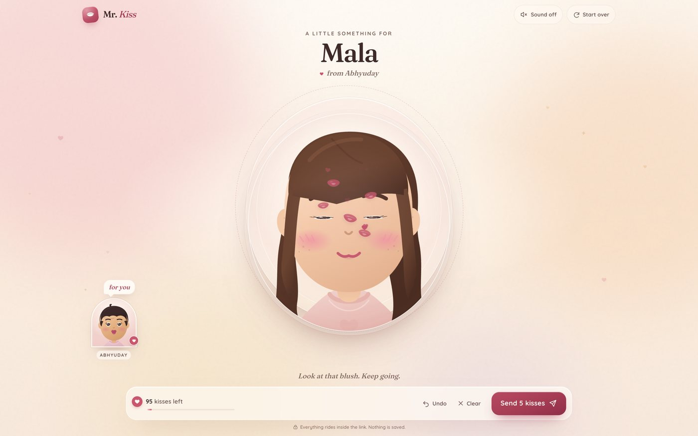
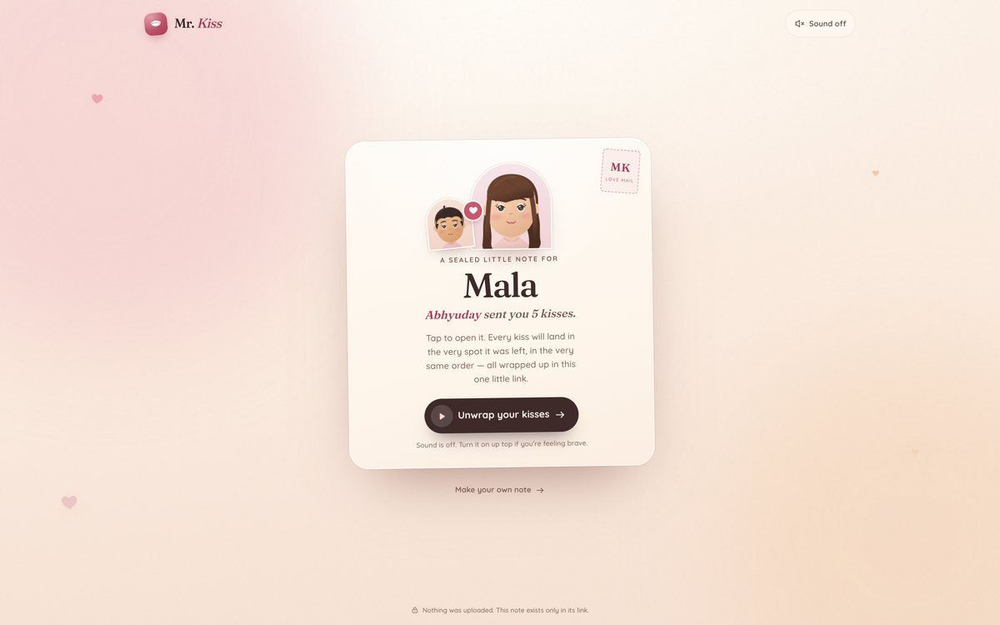
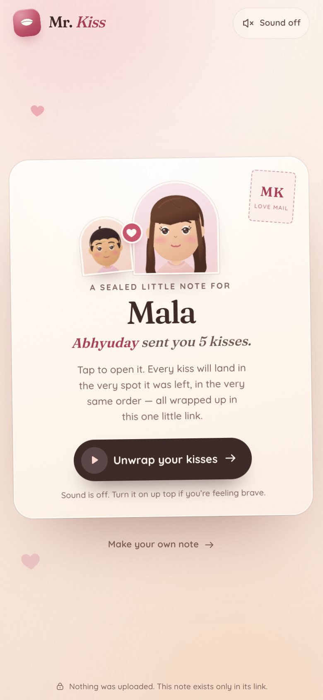

# Mr. Kiss

A little love note, sealed with a kiss.

Mr. Kiss lets you design two tiny avatars, tap kisses onto the recipient's face, and send the entire note — names, faces, timing, and every kiss — inside a single URL. No accounts, no database, no server-side love letters.

**Live production:** [https://mrkiss.online](https://mrkiss.online)



## A peek inside

<p align="center">
  
  
</p>

<p align="center">
  
  
</p>

## Run it

```bash
pnpm install
pnpm dev        # http://localhost:5173
pnpm test       # codec unit tests
pnpm check      # svelte-check
pnpm build      # static production build in dist/
pnpm preview    # serve the built site
```

The app is a static site. The production deployment is **GitHub Pages**, built and published automatically from `main`. Any other static host (Cloudflare Pages, Netlify, S3, nginx) will also work. `vite.config.ts` uses `base: './'`, so the build works at a domain root or a repository subpath. Navigation lives entirely in the hash, so no SPA rewrite rule is needed.

## Deploying to GitHub Pages

**Production URL:** [https://mrkiss.online](https://mrkiss.online)

Every push to `main` (and manual “Run workflow” dispatches) runs [`.github/workflows/deploy.yml`](./.github/workflows/deploy.yml). That workflow installs with pnpm, type-checks, runs the codec tests, builds the static site, and publishes `dist/` with the official GitHub Pages Actions. There is no `gh-pages` branch to keep in sync.

The repository is already prepared for the custom domain:

- `public/CNAME` contains `mrkiss.online` and is copied to the deployed root.
- `public/.nojekyll` prevents any Jekyll processing of the static build.
- The workflow needs **Settings → Pages → Build and deployment → Source: GitHub Actions** once. It also needs the custom domain entered under **Settings → Pages → Custom domain** (or the deployed `CNAME` will set it).
- After DNS has propagated and GitHub has issued the certificate, enable **Enforce HTTPS**.

### DNS for `mrkiss.online`

At the DNS provider for `mrkiss.online`, point the apex at GitHub Pages and `www` at the GitHub Pages hostname:

| Type    | Name  | Value                  |
| ------- | ----- | ---------------------- |
| `A`     | `@`   | `185.199.108.153`      |
| `A`     | `@`   | `185.199.109.153`      |
| `A`     | `@`   | `185.199.110.153`      |
| `A`     | `@`   | `185.199.111.153`      |
| `AAAA`  | `@`   | `2606:50c0:8000::153`  |
| `AAAA`  | `@`   | `2606:50c0:8001::153`  |
| `AAAA`  | `@`   | `2606:50c0:8002::153`  |
| `AAAA`  | `@`   | `2606:50c0:8003::153`  |
| `CNAME` | `www` | `dmjslabjsl.github.io` |

Remove any old apex `A`/`AAAA` records (for example, a registrar parking page) before adding these. If the DNS provider supports `ALIAS`/`ANAME`, the apex can alternatively point at `dmjslabjsl.github.io`. GitHub Pages serves the site at [https://dmjslabjsl.github.io/mr-kiss/](https://dmjslabjsl.github.io/mr-kiss/) as well, which is useful before DNS is switched.

### SEO checklist

The static shell includes an absolute canonical URL, Open Graph and X/Twitter cards using the absolute `https://mrkiss.online/og.jpg`, JSON-LD for the `WebSite` and `WebApplication`, and `robots.txt` + `sitemap.xml`. Note links are kept out of search results: the app switches the robots meta to `noindex, nofollow` whenever a receiver note or damaged-link screen is active. Hash fragments are client-side only, so there are no separate note pages for a crawler to index.

After DNS is verified:

1. Confirm `https://mrkiss.online/robots.txt` and `https://mrkiss.online/sitemap.xml` are reachable.
2. Add the property in Google Search Console (and optionally Bing Webmaster Tools) and submit the sitemap.
3. Test the card in the [Facebook Sharing Debugger](https://developers.facebook.com/tools/debug/) or a similar OG preview tool.
4. If the domain ever changes, update `index.html`, `public/robots.txt`, `public/sitemap.xml`, and `public/CNAME` together.

## The flow

1. **Setup** — add a From name and a To name, then optionally tweak skin, hair style, hair colour, and blush. Every look is a set of indices; the preview updates live.
2. **Stage** — the recipient's avatar sits inside a little cameo. Tap (or focus + press Enter/Space) anywhere on their face to land a kiss. Each tap records its position and time gap. The recipient blushes deeper with quick kisses, closes their eyes on contact, and the sender's mini avatar pouts and bounces. Lip marks fade where they land.
3. **Send** — the note is packed into the URL hash, copied to the clipboard, and offered to the native share sheet where available.
4. **Receive** — the link opens to a sealed-intro card. One tap starts the replay at the recorded rhythm, with a Replay and **Send one back** action at the end. Sending one back swaps names and looks and clears the kisses.

Sound is off by default. The speaker toggle enables a tiny procedurally generated smooch (no audio files) and a light haptic tap where supported. The preference is the only thing kept in `localStorage`.

## URL format

The hash is `#v1.<base64url payload>`. Hash fragments are never included in the HTTP request, so the note never reaches a server. Everything is packed into a compact binary payload:

| Bytes      | Field                                                           |
| ---------- | --------------------------------------------------------------- |
| 1          | version (`1`)                                                   |
| 4          | From look: skin, hair style, hair colour, blush (one byte each) |
| 4          | To look, same layout                                            |
| 1 + n      | From name byte length (1–16) + UTF-8 bytes                      |
| 1 + n      | To name byte length (1–16) + UTF-8 bytes                        |
| 1          | number of kisses (0–100)                                        |
| 3 × kisses | 6-bit x, 6-bit y, 12-bit time gap (20 ms units)                 |
| 1          | CRC-8 over all preceding bytes                                  |

- Coordinates are normalized to a 0–63 grid over the face box, so a kiss lands in the same relative place on any screen.
- The first kiss has a zero gap. Later gaps are clamped to 81.9 s before encoding and gently shortened to at most 1.4 s during replay, so a receiver never waits through a long thinking pause.
- Names are counted in grapheme clusters (`Intl.Segmenter`, with an `Array.from` fallback): 12 characters and 16 UTF-8 bytes maximum. A four-emoji name fits; a family emoji usually won't.
- Decoding validates the version, payload length, CRC, look indices, name bounds, kiss count, and payload length/bounds. Invalid links show a friendly “lost in the mail” screen instead of throwing.
- The CRC makes a single-character smudge detectable. It is not a security signature — anyone with the link can forge one, just as they could write a different note. It's a love note, not a bank.

At the 100-kiss limit a URL produced from a modest origin is roughly 460–520 characters, comfortably inside the ~2,000-character safe zone for messaging apps. The tests also assert the maximum packed URL stays below 700 characters.

## Technical notes

- **Vite + Svelte 5 + TypeScript.** The production bundle is small and static; there is no runtime framework server or native dependency at runtime.
- **Layered SVG avatars.** Skin, hair (back and front), ears, eyes, brows, nose, blush, mouth, sweater, accessory, and lip marks are separate SVG layers. Blush is a CSS custom property driven by the combo counter, so a continuous blush animation doesn't re-render Svelte components every frame.
- **Motion.** Idle breathing, head sway, and random soft blinks are CSS/SVG. Kiss squish and the mini bounce use the Web Animations API. The replay scheduler uses `requestAnimationFrame` and `performance.now()`, with pause/resume handling when the tab is hidden. `prefers-reduced-motion` disables movement and most transitions, while keeping the replay timing and fades.
- **Sound.** A small Web Audio synth builds the “mwah” from a filtered noise burst and a falling sine tone on first use. No audio asset is downloaded, and no sound plays before a gesture.
- **No dependencies on GSAP or Howler.** CSS transitions, the Web Animations API, and Web Audio cover the cozy bits with less JavaScript and no extra network requests. The animation code is deliberately isolated if you want to swap in GSAP or Rive later.
- **Accessibility.** The face is a real focusable button; Enter/Space lands kisses at a gentle sequence of face positions. The share sheet is a native `<dialog>` with focus management, Escape-to-close, and a labelled modal. Controls have visible focus states, the stage hint is an `aria-live` region, the end state moves focus deliberately, and the reduced-motion branch is wired through CSS and JS.
- **Privacy.** Fonts are self-hosted. There are no analytics, cookies, or third-party requests. The note lives only in the link; the sound preference is local.

## Project map

```
src/
  App.svelte                   screen router + clipboard/share + hash handling
  app.css                      design tokens and shared primitives
  lib/
    codec.ts                   binary encoder/decoder + validation
    codec.test.ts              round-trips, boundaries, corruption tests
    looks.ts                   palettes and avatar options
    types.ts                   Note / Kiss / Look
    sound.ts                   Web Audio smooch synth + preference
    share.ts                   clipboard and native share helpers
    format.ts                  labels and replay constants
    components/
      Setup.svelte             names, counters, look controls
      Avatar.svelte            layered SVG avatar
      AvatarStage.svelte       stage, hit testing, marks, squish, combo blush
      Composer.svelte          sender flow
      Receiver.svelte          intro, replay, end card, send-back
      ShareDialog.svelte       link + copy + share sheet
      ...
public/
  CNAME                        custom domain for the Pages artifact
  .nojekyll                    no Jekyll processing on Pages
  robots.txt                   crawler policy + sitemap URL
  sitemap.xml                  canonical homepage entry
  og.jpg                       social card
.github/workflows/deploy.yml   main -> GitHub Pages build and deploy
```

## Limits and choices

- **100 kisses** and **12 characters / 16 bytes per name** are deliberate, conservative limits. They keep links comfortably shareable and make the decoder strict.
- The **first gap is not replayed as a wait** — the note starts with a short lead-in.
- The **URL is the save file**. Reloading a receiver link starts the intro again; reloading the composer after sending shows the receiver's view of the sent note. Starting a new note clears the hash.
- The note's names and looks are plain text/indices in the URL. They are not encrypted; anyone who has the link can read them. The privacy promise is about servers, not about secrecy from the link holder.

## Testing notes

- `pnpm test` covers the codec: unicode names, max names, max kisses, 100-kiss URL size, gap clamping, coordinate clamping, version mismatches, truncation, single-character corruption, and look validation.
- `pnpm check` runs `svelte-check` with zero errors/warnings.
- The complete flow was exercised in Chrome at 1440×900, 820×1180, 390×844, 320×700, and 844×390, including keyboard kisses, undo, the 100-kiss boundary, clipboard + share sheet, broken links, replay/skip/send-back, and reduced-motion mode.
- A physical iOS pass is still worth doing before launch, mainly for the native share sheet, haptics (iOS ignores vibration), and Web Audio under Safari's autoplay rules. Everything is structured behind small modules (`sound.ts`, `share.ts`) if you need to adapt those.

Made for the in-between.
